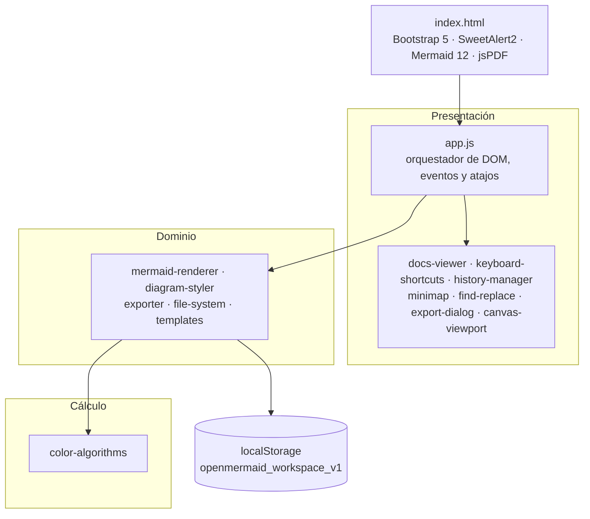

<div align="center">

# OpenMermaid Studio

**Editor de diagramas [Mermaid](https://mermaid.js.org/) con estilizado cromático algorítmico, 100 % en el navegador.**

Sin servidor · Sin *build tools* · Sin inteligencia artificial · Privacidad total

[](./LICENSE)
[](#primeros-pasos)
[](#stack-tecnológico)
[](https://mermaid.js.org/)
[](#contribuir)
[](#descripción)

Cero instalación: abre `index.html` y empieza a diagramar.

</div>

---

## Tabla de contenidos

- [Descripción](#descripción)
- [¿Por qué OpenMermaid Studio?](#por-qué-openmermaid-studio)
- [Características](#características)
- [Stack tecnológico](#stack-tecnológico)
- [Arquitectura](#arquitectura)
- [Estructura del proyecto](#estructura-del-proyecto)
- [Primeros pasos](#primeros-pasos)
- [Atajos de teclado](#atajos-de-teclado)
- [Sistema de archivos virtual](#sistema-de-archivos-virtual)
- [Motor de color algorítmico](#motor-de-color-algorítmico)
- [Suite de exportación](#suite-de-exportación)
- [API pública](#api-pública)
- [Accesibilidad y diseño responsivo](#accesibilidad-y-diseño-responsivo)
- [Compatibilidad](#compatibilidad)
- [Roadmap](#roadmap)
- [Contribuir](#contribuir)
- [Licencia](#licencia)

---

## Descripción

**OpenMermaid Studio** es una aplicación de página única (SPA) que permite escribir diagramas
[Mermaid](https://mermaid.js.org/) y verlos renderizados en tiempo real, con un **motor de color
propio** que genera paletas armónicas y accesibles (WCAG 2.1 AA) sin recurrir a ningún servicio
externo ni modelo de lenguaje.

El proyecto persigue tres objetivos:

1. **Cero fricción** — se abre `index.html` y funciona. No hay `npm install` ni paso de compilación.
2. **Privacidad total** — los diagramas viven en el `localStorage` del navegador; nada sale del equipo.
3. **Determinismo** — el mismo diagrama y la misma configuración producen siempre el mismo resultado.

---

## ¿Por qué OpenMermaid Studio?

| Criterio | OpenMermaid Studio | Editores SaaS típicos |
| --- | --- | --- |
| Ejecución | Local (navegador) | Servidor remoto |
| Privacidad de los diagramas | Total (`localStorage`) | Requiere subir el contenido |
| Coste | Gratuito (MIT) | Suscripción / límites de uso |
| Dependencia de red | Solo CDNs de librerías (cacheadas) | Siempre en línea |
| Inteligencia artificial | Ninguna (100 % algorítmico) | A menudo integrada |
| Build / instalación | Ninguna | Variable |
| Exportación a PDF | Sí (en el cliente, jsPDF) | Habitualmente de pago |
| Trazabilidad del resultado | Determinista | Depende del modelo |

---

## Características

**Edición**

- Editor en vivo con **renderizado con _debounce_** y validación de sintaxis.
- **9 tipos de diagrama**: flujo, secuencia, clases, estados, entidad-relación, Gantt, GitGraph, mindmap y gráfico circular.
- **Buscar y reemplazar** con contador de coincidencias y reemplazo puntual o global.
- **Deshacer / rehacer**, numeración de líneas y resaltado del bloque Mermaid.

**Diseño cromático**

- **Estilizado cromático algorítmico**: paletas monocromática, análoga, complementaria y triádica.
- **Motor matemático de color**: conversiones HEX ⇄ RGB ⇄ HSL, luminancia relativa, ratio de contraste
  y selección automática de texto legible (WCAG 2.1 AA).
- **Generador de paleta aleatoria inteligente** con verificación de contraste.
- Control de **orientación** del flujo (inyección/eliminación de `%%{init}%%` y `classDef`).

**Organización**

- **Sistema de archivos virtual** en `localStorage`: árbol de carpetas, crear/renombrar/eliminar,
  *Guardar* y *Guardar como*, con métricas de uso.
- **Respaldo y restauración** del espacio de trabajo completo en un único archivo JSON.
- **Historial de versiones** por diagrama: snapshots automáticos en cada guardado, con restauración y vaciado.

**Visualización**

- **Zoom y desplazamiento** del lienzo, **ajuste automático** (*auto-fit*) y nitidez vectorial
  (`shape-rendering` / `text-rendering`).
- **Minimapa de navegación** con recuadro de la región visible; clic y arrastre para desplazar la vista.
- **Modo presentación** a pantalla completa, con tema claro/oscuro persistente y barra lateral colapsable.

**Exportación y entrega**

- **Suite de exportación**: SVG, PNG (1× / 2× / 3× / 4×, **siempre sin fondo**), PDF A4, código fuente `.mmd`
  y copiado al portapapeles.
- **Marca de agua** opcional (SVG/PNG/PDF): nombre del diagrama, autor y fecha.
- **Portal de documentación embebido** estilo *Developer Portal*, con catálogo de operaciones,
  sintaxis soportada y métricas de almacenamiento en vivo.
- **Sistema centralizado de atajos** con hoja de referencia integrada (tecla `?`).

---

## Stack tecnológico

| Capa | Tecnología |
| --- | --- |
| Interfaz | HTML5 semántico + [Bootstrap 5.3.3](https://getbootstrap.com/) (tema claro/oscuro vía `data-bs-theme`) |
| Iconografía | [Material Symbols Outlined](https://fonts.google.com/icons) |
| Tipografías | [Inter](https://fonts.google.com/specimen/Inter) (UI) · [JetBrains Mono](https://fonts.google.com/specimen/JetBrains+Mono) (código) |
| Render de diagramas | [Mermaid 12](https://mermaid.js.org/) |
| Diálogos y avisos | [SweetAlert2 v11](https://sweetalert2.github.io/) |
| PDF | [jsPDF 2.5.1](https://github.com/parallax/jsPDF) |
| Lógica | JavaScript **vanilla** (ES2020), patrón IIFE sobre `window.OpenMermaidStudio` |
| Persistencia | `localStorage` (`openmermaid_workspace_v1`) |
| Empaquetado | Ninguno — archivos estáticos |

---

## Arquitectura

La aplicación usa **scripts clásicos (IIFE) sobre un namespace global** (`window.OpenMermaidStudio`)
en lugar de módulos ES: los `import`/`export` fallan bajo el esquema `file://` por CORS, mientras que
los *scripts* clásicos permiten abrir el editor con doble clic, sin servidor.



Cada módulo es independiente y solo se comunica a través del namespace compartido, lo que facilita
su prueba por separado con `node` o `jsdom`.

---

## Estructura del proyecto

```text
.
├── index.html                 # Estructura de la interfaz y carga ordenada de scripts
├── css/
│   └── styles.css             # Layout, sidebar, splitter, lienzo, portal de docs y responsive
├── js/
│   ├── color-algorithms.js    # Motor matemático de color y armonías (WCAG)
│   ├── templates.js           # Catálogo de 9 plantillas de diagramas
│   ├── diagram-styler.js      # Inyección de %%{init}%%, orientación y classDef
│   ├── file-system.js         # FileSystemManager (árbol + localStorage + historial)
│   ├── mermaid-renderer.js    # Render, validación y normalización de errores
│   ├── exporter.js            # SVG, PNG, PDF, .mmd, portapapeles y marca de agua
│   ├── export-dialog.js       # Modal de exportación y avisos (SweetAlert2)
│   ├── docs-viewer.js         # Portal de documentación y métricas
│   ├── keyboard-shortcuts.js  # Sistema centralizado de atajos y hoja de referencia
│   ├── history-manager.js     # Panel de historial de versiones
│   ├── minimap.js             # Minimapa de navegación (geometría + arrastre)
│   ├── find-replace.js        # Barra de búsqueda y reemplazo del editor
│   ├── canvas-viewport.js     # Utilidades de viewport del lienzo
│   └── app.js                 # Orquestador: DOM, eventos y despacho de atajos
├── img/
│   └── logo.ico               # Icono de la aplicación
├── LICENSE
└── README.md
```

---

## Primeros pasos

### Uso local

1. Descarga o clona el repositorio.
2. Abre `index.html` en el navegador (doble clic).

Las librerías se cargan desde CDN, por lo que la **primera** vez se necesita conexión a Internet
(el navegador las cachea después). No hay dependencias que instalar.

### Publicación estática

Al ser un sitio puramente estático, puede desplegarse en cualquier hosting de archivos:

- **GitHub Pages** — publica la rama con los archivos en la raíz del repositorio.
- **Netlify / Vercel / Cloudflare Pages** — usa el directorio del proyecto como *publish directory*.
- **Servidor propio** — copia la carpeta completa al directorio público.

No requiere configuración de servidor, variables de entorno ni procesos en segundo plano.

---

## Atajos de teclado

Todos los atajos se definen en un único catálogo (`KeyboardShortcuts.CATALOGO_DE_ATAJOS`) que alimenta
tanto el despacho de eventos como la hoja de referencia integrada (tecla `?`).

| Atajo | Acción |
| --- | --- |
| `Ctrl/Cmd + S` | Guardar el diagrama activo |
| `Ctrl/Cmd + Shift + S` | Guardar como… (nuevo archivo) |
| `Ctrl/Cmd + O` / `Ctrl/Cmd + B` | Mostrar/ocultar el explorador |
| `Ctrl/Cmd + G` | Crear un diagrama nuevo |
| `Ctrl/Cmd + E` | Exportar SVG vectorial |
| `Ctrl/Cmd + H` | Historial de versiones |
| `Ctrl/Cmd + F` | Buscar en el código |
| `Ctrl/Cmd + Shift + F` | Buscar y reemplazar |
| `Ctrl/Cmd + /` | Comentar / descomentar líneas (`%%`) |
| `Ctrl/Cmd + Z` / `Y` | Deshacer / rehacer |
| `Ctrl/Cmd + +` / `-` | Acercar / alejar el zoom |
| `Ctrl/Cmd + 0` | Restablecer el zoom al 100 % |
| `Ctrl/Cmd + M` | Mostrar/ocultar el minimapa |
| `F10` o `Alt + Enter` | Activar/desactivar el modo presentación |
| `F1` o `?` (fuera del editor) | Mostrar la referencia de atajos |
| `Esc` | Cerrar la superposición activa |

---

## Sistema de archivos virtual

El espacio de trabajo se serializa en `localStorage` bajo la clave `openmermaid_workspace_v1`:

```jsonc
{
  "version": 1,
  "configuracion": {
    "tema": "oscuro",             // "claro" | "oscuro"
    "sidebarVisible": true,
    "archivoActivoId": "a1b2c3",
    "matizBase": 213,             // grados 0-359
    "saturacionBase": 68,         // porcentaje 0-100
    "tipoEsquema": "analogo",     // monocromatico | analogo | complementario | triadico
    "incluirClasesDeEstilo": false,
    "marcaDeAguaActiva": false,
    "autorMarcaDeAgua": "",
    "minimapaVisible": false
  },
  "carpetas": [
    { "id": "raiz", "nombre": "Mis Diagramas", "esRaiz": true, "fechaCreacion": 1700000000000 }
  ],
  "archivos": [
    {
      "id": "a1b2c3",
      "carpetaId": "raiz",
      "nombre": "diagrama-flujo.mmd",
      "codigo": "flowchart TD\n  A --> B",
      "fechaModificacion": 1700000000000,
      "historial": [
        { "id": "version-1", "fecha": 1700000000000, "codigo": "flowchart TD\n  A --> B" }
      ]
    }
  ]
}
```

- El campo `historial` guarda hasta **10 snapshots** por archivo (`LIMITE_VERSIONES_HISTORICAS`),
  del más reciente al más antiguo, evitando duplicar versiones idénticas.
- El gestor aplica un límite de uso de **5 MB** (`LIMITE_ALMACENAMIENTO_BYTES`) y expone métricas de
  ocupación en la barra de estado y en el portal de documentación.

---

## Motor de color algorítmico

Cada armonía deriva tres matices a partir de un matiz base (`CATALOGO_ARMONIAS`):

| Esquema | Desplazamientos de matiz | Resultado |
| --- | --- | --- |
| Monocromático | `0, 0, 0` | Variaciones del mismo tono |
| Análogo | `-30, 0, 30` | Colores vecinos en la rueda |
| Complementario | `0, 180, 180` | Máximo contraste de matiz |
| Triádico | `0, 120, 240` | Triángulo equidistante |

Para cada par fondo/texto se calcula la **luminancia relativa** y el **ratio de contraste** según
WCAG 2.1. Si no alcanza el umbral AA (`4.5:1`), `determinarColorDeTextoAccesible` selecciona
automáticamente texto claro u oscuro y, si es necesario, ajusta la luminosidad hasta garantizar la
legibilidad.

---

## Suite de exportación

| Formato | Detalles |
| --- | --- |
| **SVG** | Vectorizado, autocontenido, con estilos en línea y dimensiones/namespaces explícitos. |
| **PNG** | Escalas 1× / 2× / 3× / 4× con *super-sampling* vía Canvas API; **siempre sin fondo** (transparente). |
| **PDF** | Documento A4 con orientación automática y el diagrama centrado (jsPDF en el cliente). |
| **`.mmd`** | Código fuente Mermaid tal cual, para reutilizar en otros editores. |
| **Portapapeles** | Copia del código, del SVG o de la imagen PNG. |
| **Marca de agua** | Opcional: nombre del diagrama, autor y fecha en una píldora inferior derecha. |

> **Nota técnica:** las etiquetas se renderizan como `<text>`/`<tspan>` nativos de SVG
> (`htmlLabels: false`) y la rasterización neutraliza `<foreignObject>` e imágenes externas. Así se
> evita que el lienzo quede «tainted» y `toBlob`/`toDataURL` funcionan incluso al abrir la aplicación
> con el protocolo `file://`.

---

## API pública

Todos los módulos exponen sus funciones a través de `window.OpenMermaidStudio`:

| Módulo | Acceso | Funciones destacadas |
| --- | --- | --- |
| Color | `OpenMermaidStudio.ColorAlgorithms` | `generarPaletaArmonica`, `calcularRatioDeContraste`, `determinarColorDeTextoAccesible` |
| Plantillas | `OpenMermaidStudio.Templates` | catálogo `CATALOGO_DE_PLANTILLAS` |
| Estilizado | `OpenMermaidStudio.DiagramStyler` | `inyectarDirectivaInit`, `alternarOrientacionDeFlujo`, `inyectarClasesDeEstiloEnFlujo` |
| Archivos | `OpenMermaidStudio.FileSystemManager` | gestión de árbol, guardado, versiones y respaldo |
| Render | `OpenMermaidStudio.MermaidRenderer` | `intentarRenderizarDiagrama`, `normalizarSvgRenderizado` |
| Exportación | `OpenMermaidStudio.Exporter` | `exportarSvgLimpio`, `exportarPngAltaResolucion`, `exportarPdfVectorial`, `copiarPngAlPortapapeles` |
| Diálogo de exportación | `OpenMermaidStudio.ExportDialog` | `abrirDialogoDeExportacion`, `notificarExito`, `notificarError` |
| Documentación | `OpenMermaidStudio.DocsViewer` | `inicializarVisorDeDocumentacion`, `refrescarMetricasDeAlmacenamiento` |
| Atajos | `OpenMermaidStudio.KeyboardShortcuts` | `inicializarAtajosDeTeclado`, `CATALOGO_DE_ATAJOS` |
| Historial | `OpenMermaidStudio.HistoryManager` | `inicializarGestorDeHistorial`, `abrirPanelDeHistorial` |
| Minimapa | `OpenMermaidStudio.Minimap` | `inicializarMinimapa`, `actualizarMinimapa` |
| Buscar/reemplazar | `OpenMermaidStudio.FindReplace` | `abrirPanelDeBusqueda`, `reemplazarTodos` |
| Lienzo | `OpenMermaidStudio.CanvasViewport` | utilidades de transformación del viewport |

---

## Accesibilidad y diseño responsivo

- **Contraste**: toda paleta generada se verifica contra el umbral **WCAG 2.1 AA** (`4.5:1`).
- **Teclado**: atajos globales, foco visible y `Esc` para cerrar superposiciones.
- **Responsive**: interfaz adaptada con puntos de quiebre en `1200`, `1024`, `991`, `768`, `576` y
  `400` px. En móvil la barra pasa a modo solo-icono y la barra lateral se convierte en un panel
  deslizante.

---

## Compatibilidad

- **Navegadores**: versiones modernas de Chrome, Edge, Firefox y Safari.
  Requiere `canvas`, `localStorage`, `Blob` y `navigator.clipboard`.
- **Mermaid**: versión 12 (cargada desde CDN).
- El editor es totalmente usable abriendo el archivo local (`file://`); algunas capacidades
  (portapapeles de imagen) funcionan mejor servidas por HTTP(S).

---

## Roadmap

- [ ] Diagramas adicionales de Mermaid 12 (requirement, quadrant, timeline, sankey).
- [ ] Exportación a SVG/PNG con selección de área.
- [ ] Empaquetado opcional como PWA instalable y 100 % offline.
- [ ] Importación de archivos `.mmd` desde el sistema local.
- [ ] Modo de comparación de versiones en el historial.

> ¿Tienes una idea? Abre un _issue_ o envía un _pull request_.

---

## Contribuir

Las contribuciones son bienvenidas. Para mantener la coherencia del proyecto:

1. Haz un _fork_ y crea una rama descriptiva (`feat/mi-mejora`).
2. Respeta el estilo existente: **nombres y comentarios en español**, IIFE, `'use strict'` y JSDoc.
3. No introduzcas dependencias de build ni frameworks adicionales.
4. Verifica que los archivos sigan siendo válidos (`node --check js/*.js`).
5. Abre un _pull request_ describiendo el cambio y cómo probarlo.

---

## Licencia

Distribuido bajo la licencia **MIT**. Consulta el archivo [LICENSE](./LICENSE) para más detalles.

Copyright © 2026 **KevinGil12C**.

<div align="center">

Hecho con JavaScript vanilla, matemáticas deterministas y mucho cariño por los diagramas.

</div>
